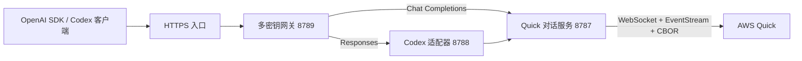

# AWS Quick OpenAI Gateway

将自己已登录的 AWS Quick 会话接入 OpenAI 风格的文本 API，并提供一个实验性 Codex Responses 适配层和可撤销的多用户 API key 网关。

**这不是 AWS 或 OpenAI 的官方项目。** 上游使用 Quick 网页私有协议，可能随产品更新变化。模型名 `quick` 代表 Quick smart 模式，不代表 GPT。Codex 工具调用通过文本 JSON 模拟，仍需核对实际命令执行记录。

## 功能概览

| 组件 | 端口 | 作用 |
| --- | --- | --- |
| quick-proxy | 127.0.0.1:8787 | Quick EventStream/CBOR ↔ 文本 Chat Completions |
| bridge | 127.0.0.1:8788 | Codex Responses ↔ Quick 文本 JSON 动作 |
| quick-api-gateway | 127.0.0.1:8789 | 独立 API key、限流、撤销、历史归属校验 |
| HTTPS 入口 | 按部署配置 | Cloudflare Tunnel 或自己的反向代理 |



网关不执行调用者的 shell 命令。Codex 工具由调用者自己的客户端按照其权限和审批配置执行。

## 五分钟本地启动

需要 **Node.js 22+、npm、自己的有效 AWS Quick 登录会话**。Windows 辅助脚本按 PowerShell 7 验证。不需要付费 OpenAI API key。

### 1. 安装依赖并运行测试

```sh
git clone https://github.com/2032046053/aws-quick-openai-gateway.git
cd aws-quick-openai-gateway
npm run setup
npm test
```

测试使用模拟上游，不需要 AWS Cookie，也不访问真实 Quick。可选 CBOR 原生优化未运行安装脚本，使用 JavaScript 实现即可。

### 2. 导入自己的 Quick 会话

在浏览器登录 Quick，打开开发者工具 Network，清空旧记录后刷新页面、发送一条最小测试消息。找到 `ChatBidirectionalStream` WebSocket 请求：

- 导出本次 Network 记录为 `quick.har`。
- 将该请求的完整 Cookie 头值保存为单行 `cookie.txt`。
- HAR 与 Cookie 必须来自同一次登录，不要使用仓库示例或别人的会话。

```sh
cd quick-proxy
node import-session.mjs /path/to/quick.har /path/to/cookie.txt
npm start
```

如本机需要出站代理，可在导入命令最后增加 `http://127.0.0.1:7897`，按自己的网络修改。

首次导入会在本机生成 `.env`、`session.local.json` 和 `client.local.json`，均被 Git 忽略。后者包含本地内部 API key。不要把这些文件提交到仓库。

### 3. 调用 Chat Completions

```python
from openai import OpenAI

client = OpenAI(
    base_url="http://127.0.0.1:8787/v1",
    api_key="client.local.json 中的 apiKey",
)
result = client.chat.completions.create(
    model="quick",
    messages=[{"role": "user", "content": "你好"}],
)
print(result.choices[0].message.content)
```

流式输出使用 `stream=True`，读取 `chunk.choices[0].delta.content`。不要显式传入 temperature、max_tokens、tools 等未实现参数，服务会返回 400，而不是假装应用这些配置。

## 接入 Codex / Responses

打开另一个终端，设置原始内部客户端配置文件的**绝对路径**：

```powershell
$env:QUICK_CLIENT_FILE = 'C:\path\aws-quick-openai-gateway\quick-proxy\client.local.json'
node .\bridge\adapter.mjs
```

Linux/macOS：

```sh
QUICK_CLIENT_FILE=/absolute/path/quick-proxy/client.local.json node bridge/adapter.mjs
```

Responses 地址为 `http://127.0.0.1:8788/v1`，模型 `quick`，使用同一个内部 key。

Windows 可运行 `bridge/Start-Codex.ps1`，它使用隔离的 Codex home 和 demo，保留 workspace-write / on-request，并设置 Windows sandbox=elevated。脚本依赖已安装的 Codex CLI；未来 CLI 参数变化时需要同步调整。只应在项目副本上试验。

默认过滤大型插件/MCP 工具定义，仅保留核心编程工具。`QUICK_CODEX_TOOLS=all` 转发全部工具，或设置逗号分隔的工具名称白名单。桌面客户端的大量工具和长历史仍可能触发 413 或上游 502。

### 会话复用与输入减重

- Chat Completions 根据调用者和完整历史前缀复用 Quick 对话，正常续轮只发送新增消息；不会用大家相同的首条系统提示词绑定会话。
- Responses 的 previous_response_id 链和可唯一匹配的完整历史共用一个原生 Quick 对话，续轮只发新增事件。指令/工具配置变化或分支冲突时新建独立上下文。
- 包装规则压缩为五行；工具用函数签名表示，删除冗长描述，保留必填项、类型、枚举和其他参数约束，以及 custom 工具的格式定义。
- 每个工具返回值最多 2000 字符：头部 500 字符、截断标记及剩余尾部；不截断用户消息或 instructions。

Responses 完成结果的 metadata 会给出 quick_conversation_id、quick_reused、quick_sent_chars，便于验证实际复用与发往 AWS 的消息长度。长度优化的比例依赖原始工具、指令和历史大小，不承诺每个请求固定减少 70%。

## 给其他人使用独立密钥

不要将内部 `client.local.json` 交给调用者。启用网关：

```powershell
cd quick-api-gateway
$env:QUICK_CLIENT_FILE = (Resolve-Path ..\quick-proxy\client.local.json).Path
$env:PUBLIC_BASE_URL = 'https://api.example.com/quick/v1'
node keys.mjs create alice
npm start
```

Linux 使用 `export QUICK_CLIENT_FILE=...`、`export PUBLIC_BASE_URL=...`。创建结果只打印密钥 ID 和用户配置文件路径；实际 key 保存在 `clients/<ID>.json`。

调用者使用外部 Base URL、`model=quick`、其个人 `apiKey`。支持：

```text
GET  /v1/models
POST /v1/chat/completions
POST /v1/responses
```

网关也接受 `/quick/v1/...`，适合在已有域名下分配 `/quick` 前缀。

默认每个 key 每分钟 20 次、一个并发，所有网关调用最多两个并发。限流计数在内存中，重启会重置。所有调用仍使用**同一个 Quick 账户及其额度**，不提供独立 AWS 账户隔离或计费系统。

## 文档导航

- [VPS / HTTPS 部署](docs/DEPLOYMENT.md)：systemd、权限、Cloudflare 路由、备份和维护。
- [会话过期与切换账号](docs/SESSION.md)：重新抓取、验证后切换、回滚与 API key 保留。
- [API 与密钥管理](docs/API.md)：请求示例、权限、撤销、错误码、历史隔离。
- [协议与兼容边界](docs/ARCHITECTURE.md)：真实二进制协议、Responses 模拟、上下文处理。
- [排障与验证](docs/TROUBLESHOOTING.md)：401、403、413、429、502、流式与工具执行真实性。
- [敏感信息处理](SECURITY.md)：哪些文件不能上传、泄露后如何处理。

## 已验证范围

历史部署中已用真实 Quick 验证文本非流式、文本 SSE、文本多轮历史，以及经 HTTPS 网关的 Responses、续接、跨 key 历史拒绝和密钥撤销。会话复用改造的 19 项本地模拟测试通过；另在真实 Quick 完成三轮记忆测试和四次实际 Node 命令执行，见[减重实测](docs/OPTIMIZATION.md)。附带的 CI 模板不使用真实账户；模拟测试不能证明未来 AWS 会话、网络或每次模型回答可靠。

曾观察到 Quick 在没有执行测试命令时编造测试输出。因此任何“测试通过”“文件已修改”的结论都应以客户端的真实工具记录和独立检查为准。

## 目录结构

```text
quick-proxy/          Quick WebSocket 客户端、Chat Completions、原始透明反代
bridge/               Codex Responses 适配器与 Windows demo 启动脚本
quick-api-gateway/    多 key 网关、管理员脚本、会话同步、验证脚本
deploy/               VPS 安装器、Cloudflare/Caddy 示例、可选 CI 模板
docs/                 部署、API、会话、协议与排障说明
scripts/              依赖安装辅助脚本
```

参考：[AWS EventStream](https://smithy.io/2.0/aws/amazon-eventstream.html)、[Cloudflare Tunnel 路由](https://developers.cloudflare.com/cloudflare-one/networks/connectors/cloudflare-tunnel/do-more-with-tunnels/local-management/configuration-file/)。
